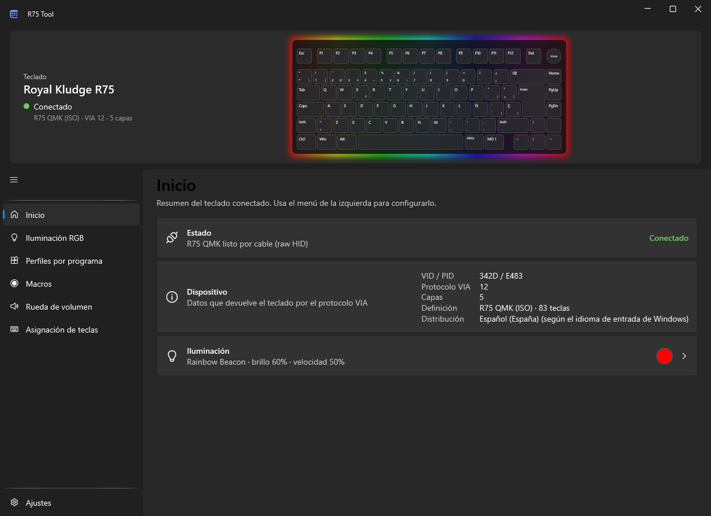
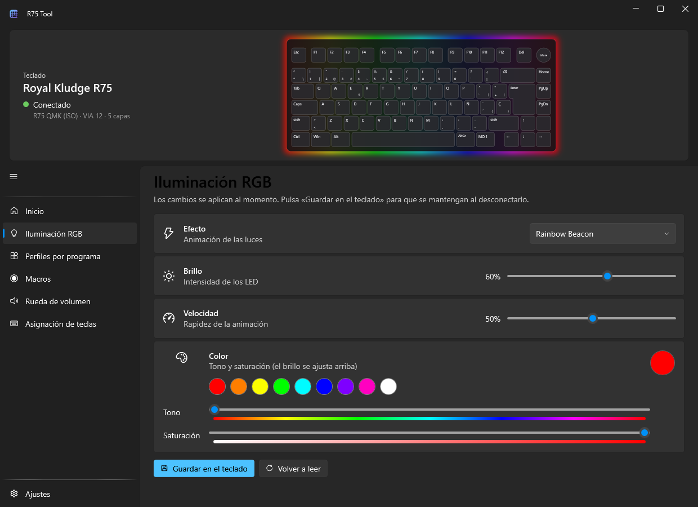
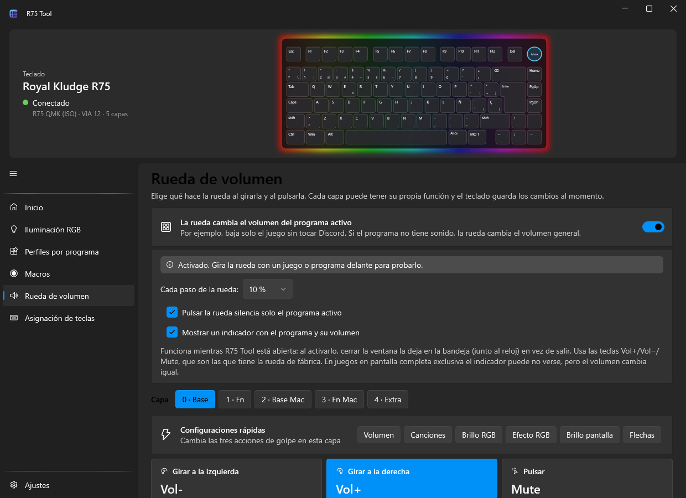
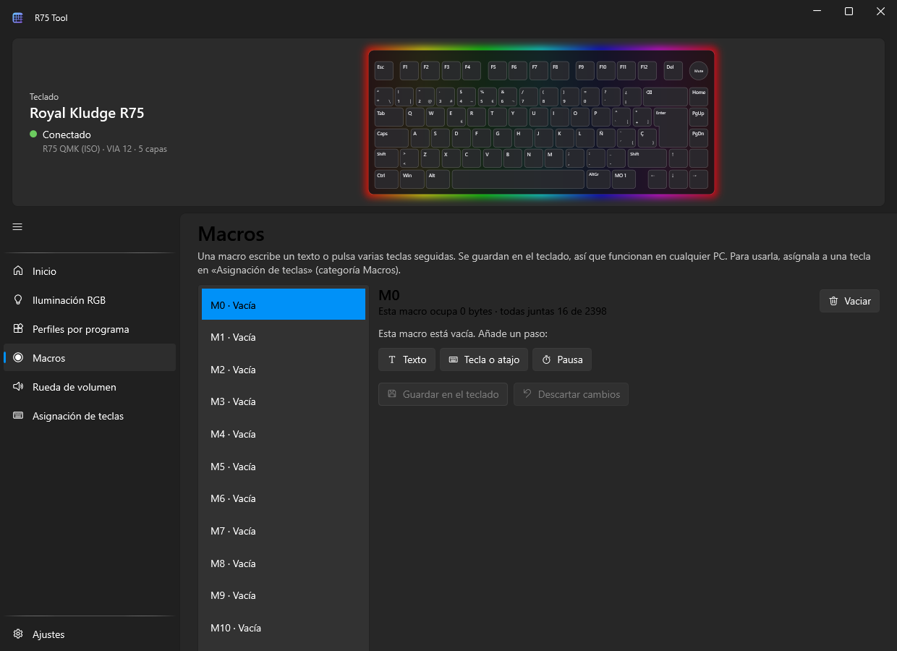

# R75 Tool

App de escritorio (WPF, .NET 10) para configurar el teclado **Royal Kludge R75** con cable (firmware QMK/VIA) sin el software oficial. Habla con el teclado mediante el protocolo **raw HID de VIA**.

Su función estrella: **la rueda del teclado cambia solo el volumen del programa que tienes delante**. Por ejemplo, bajas el juego sin tocar Discord ni la música.



## Funciones

| Apartado | Qué hace |
| --- | --- |
| Inicio | Estado del teclado y dibujo generado a partir de su definición VIA (ISO español o ANSI) |
| Iluminación RGB | Efecto, color, brillo y velocidad, en directo; «Guardar» lo deja en el teclado |
| Perfiles por programa | Iluminación distinta según el programa activo |
| Macros | 16 macros guardadas en el teclado: texto (con tildes y símbolos españoles), atajos y pausas |
| Rueda de volumen | Qué hace la rueda al girarla y pulsarla en cada capa, y **volumen por aplicación** |
| Asignación de teclas | Cambiar cualquier tecla de las 5 capas, deshacer y restaurar de fábrica |
| Ajustes | Distribución, bandeja del sistema, iniciar con Windows y copia de seguridad del teclado |

| Iluminación | Rueda de volumen | Macros |
| --- | --- | --- |
|  |  |  |

## Requisitos

- Windows 10/11 y el [SDK de .NET 10](https://dotnet.microsoft.com/download).
- Royal Kludge R75 **por cable** con firmware QMK/VIA (probado con el R75 ISO, PID `E483`).
- El software oficial de RK debe estar cerrado (no pueden usar el teclado los dos a la vez).
- El volumen por aplicación funciona con cualquier teclado que tenga teclas de volumen.

## Estructura

```
src/R75Tool.Core/     Librería sin interfaz
  ViaKeyboard.cs        Conexión HID y comandos VIA (32 bytes por paquete)
  RgbMatrix.cs          Iluminación: canal 3 de VIA (brillo, efecto, velocidad, color)
  Knob.cs               Rueda: encoder 0 (giro) + su tecla en la matriz (pulsación)
  Macro.cs              Pasos de macro y su codificación en el buffer de QMK
  KeyboardBackup.cs     Copia de seguridad completa en JSON
  KeyboardDefinition.cs Lee el JSON de VIA (layout KLE, efectos)
  KeyboardConnection.cs Conexión automática, desconexión y cola de comandos
  KeycodeNames.cs       Catálogo de keycodes de QMK (etiqueta, descripción, categoría)
  HostLayout.cs         Distribución de Windows (español / inglés): qué carácter es cada tecla
src/R75Tool.App/      App WPF con WPF-UI (tema oscuro de Windows 11)
  Assets/               Definiciones VIA (ANSI = PID E484, ISO = PID E483) e icono
  Controls/             Dibujo del teclado, selector de keycodes, editor de iluminación
  Views/                Páginas del menú lateral
  AppSettings.cs        Ajustes y perfiles (%AppData%\R75Tool\settings.json)
  ProfileService.cs     Detecta el programa en primer plano y aplica su perfil
  TrayIcon.cs           Icono en la bandeja del sistema
  Audio/                Volumen por aplicación: hook de las teclas de volumen,
                        sesiones de audio de Windows (NAudio) e indicador en pantalla
tools/RkDiag/         Herramienta de diagnóstico por consola (usa la misma librería)
```

## Compilar y ejecutar

Requiere el SDK de .NET 10 en Windows.

```powershell
dotnet run --project src/R75Tool.App
```

Diagnóstico por consola:

```powershell
dotnet run --project tools/RkDiag            # solo lee
dotnet run --project tools/RkDiag -- matriz  # vuelca toda la matriz de teclas
dotnet run --project tools/RkDiag -- brillo 128
```

## Notas

- El teclado tiene que estar **por cable**, y el software oficial de RK debe estar **cerrado**.
- Los cambios de iluminación son temporales hasta que se pulsa **Guardar en el teclado** (comando VIA `0x09`).
- Los cambios de teclas, en cambio, el teclado los guarda al momento (QMK los escribe en la EEPROM).
- Capas del R75 (deducidas de su contenido): 0 Windows, 1 Fn, 2 Mac, 3 Fn Mac, 4 extra.
- Cuidado con Fn+Espacio en el firmware de fábrica: es `QK_CLEAR_EEPROM` (0x7C03) y borra la configuración guardada.
- En el R75 el indicador "clockwise" de VIA para la rueda va al revés que el giro físico (ver `Knob.cs`).
- El teclado solo envía keycodes; qué carácter es cada uno lo decide Windows. Por eso las teclas de símbolos se dibujan según el idioma de entrada de Windows (`HostLayout.cs`: español de España o inglés de EE. UU.).
- El brillo se lee redondeado (p. ej. 60 → 59) porque QMK lo guarda en otra escala; `RgbMatrix.SetBrightnessExact` lo compensa.
- QMK escribe el texto de las macros suponiendo teclado inglés; por eso, salvo letras y números, la app guarda el texto como pulsaciones calculadas con la distribución (incluidas las tildes con tecla muerta).
- Volumen por aplicación: la app intercepta Vol+/Vol−/Mute con un hook de teclado (`WH_KEYBOARD_LL`) y cambia el volumen de las sesiones de audio del programa en primer plano y de sus procesos auxiliares sin ventana. Si ese programa no tiene sonido, devuelve la tecla a Windows.
- En la bandeja la ventana se destruye (y se vuelve a crear al abrirla) para que la app ocupe solo unos MB de RAM mientras funciona en segundo plano. Solo puede haber una instancia abierta.
- Los perfiles cambian la iluminación sin guardarla, para no desgastar la EEPROM del teclado.

## Licencia

[MIT](LICENSE).

R75 Tool no está relacionado con Royal Kludge. «Royal Kludge» y «R75» son marcas de sus respectivos propietarios.

## Dependencias

- [HidSharp](https://www.nuget.org/packages/HidSharp) — acceso a dispositivos HID
- [WPF-UI](https://github.com/lepoco/wpfui) — controles con estilo Windows 11
- [NAudio](https://github.com/naudio/NAudio) — sesiones de audio de Windows (volumen por aplicación)
